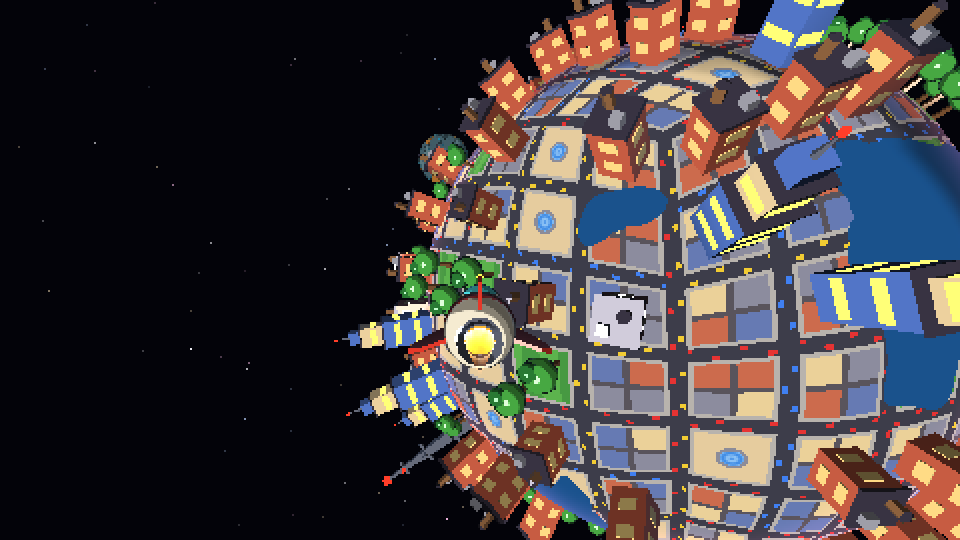
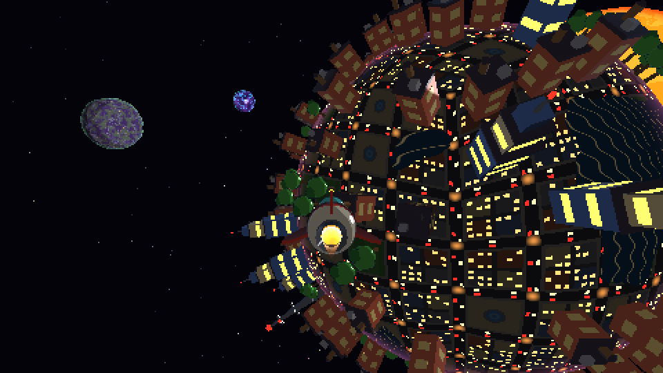
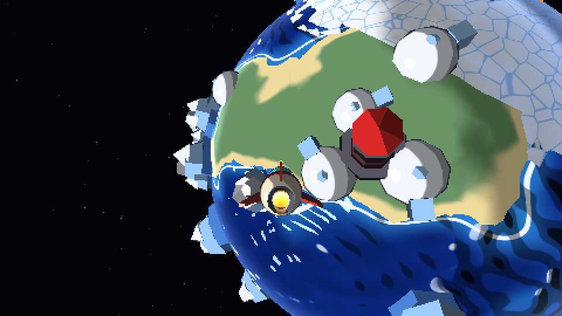
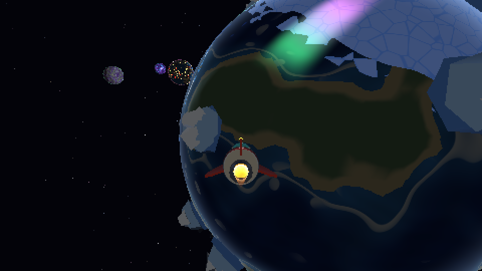

# Proyecto 3 — Sistema solar con software renderer

Un pequeño sistema solar estilo "mini-mundos" que se explora volando un
cohete. Todo el 3D (transformaciones, recorte, rasterización, z-buffer,
shaders) está implementado en este repositorio; raylib solo se usa para la
ventana, la entrada y mostrar el framebuffer.

| Jungla jurásica | Planeta embrujado |
|---|---|
|  |  |


| Lava | Desierto y anillo de asteroides |
|---|---|
|  |  |

| Mecánico | Cristalino |
|---|---|
|  |  |

| Ciudad (día) | Ciudad (noche) |
|---|---|
|  |  |

| Hielo / océano | Hielo de noche, con aurora |
|---|---|
|  |  |

> 🚧 En desarrollo. Ver [PENDIENTES.md](PENDIENTES.md) para el estado de la
> rúbrica y lo que falta.

## Integrantes

| Nombre | Carné | Contribución |
|---|---|---|
| Martin Villatoro | 24033 | Pipeline de rasterización, nave y física, colisiones, planetas/LOD/culling |
| Esteban de la Peña | 24171 | Planetas Lava, Desierto, Mecánico y Cristalino, shaders, modelos y anillo de asteroides (`src/mundos/esteban.rs`) |
| Emily Góngora | 24308 | Planetas Ciudad y Hielo / océano: shaders (cuadrícula de calles por proyección de cubo, tráfico y luces nocturnas; olas con normal mapping procedural, espuma, casquetes y aurora), distribución de edificios en la cuadrícula y colonias de pingüinos, modelos (`src/mundos/emily/`, `assets/models/modelos_emily.py`) |

## Cómo ejecutar

Requisitos: Rust estable y `cmake` (macOS: `brew install cmake`).

```bash
cargo run --release
```

## Controles

| Tecla | Acción |
|---|---|
| W / S | Acelerar / frenar (reversa suave) |
| Mouse o flechas | Cabeceo y guiñada (el mouse mueve una palanca virtual) |
| A / D | Alabeo (rodar) |
| Espacio / Ctrl | Subir / bajar |
| Shift | Turbo |
| C | Cámara: tercera persona / cabina |
| R | Reiniciar la nave |
| Tab / Esc | Soltar / capturar el mouse |
| F1 | Panel de depuración (contadores del pipeline) |
| F2 | Cámara libre de depuración |
| F3 / F4 | Activar / desactivar culling y LOD (comparación) |

## Arquitectura

| Archivo | Qué hace |
|---|---|
| `src/math.rs` | Vectores y matrices propios (look-at, perspectiva, rotaciones) |
| `src/renderer.rs` | Pipeline: vertex stage, recorte, backface, rasterización multihilo, z-buffer |
| `src/mesh.rs` | Icosfera subdividida, cono, cargador `.obj`/`.mtl` |
| `src/noise.rs` | Perlin 3D con semilla, fBm, ridged, ruido celular (Worley) |
| `src/planet.rs` / `src/planets.rs` | Planetas: órbita, giro, terreno deformado, LODs / catálogo |
| `src/scene.rs` | Culling, selección de LOD y orden de dibujo |
| `src/ship.rs` | Física de vuelo con paso fijo de 120 Hz |
| `src/collision.rs` | Colisión nave–planeta con la altura real del terreno |
| `src/props.rs` | Objetos de superficie: distribución con semilla y ruido, orientación, horneado; fantasmas |
| `src/shaders/` | Fragment shaders: sol, jungla, embrujado, toon (nave y objetos), flama, fantasma |
| `assets/models/nave_cohete.py` | Script de Blender que genera la nave |
| `assets/models/modelos_superficie.py` | Script de Blender: palmera, helecho, esqueleto, árbol seco, lápida, casona, fantasma |

## Uso de IA

- **Emily Góngora:** usé un asistente de IA (Claude) como apoyo para escribir
  el código de los planetas Ciudad y Hielo (shaders y reglas de colocación en
  `src/mundos/emily/`), el script de modelos `assets/models/modelos_emily.py`
  y para iterar el aspecto con capturas y `--bench`. Revisé, probé y puedo
  explicar todo el código entregado.
