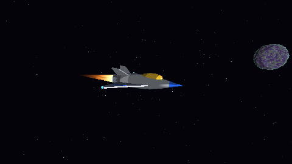
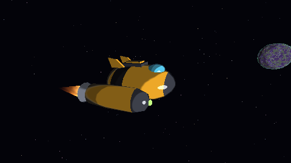
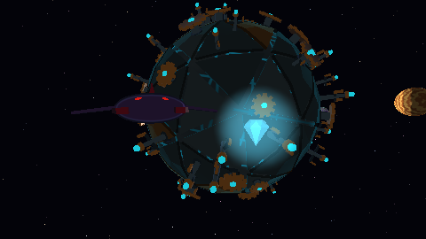
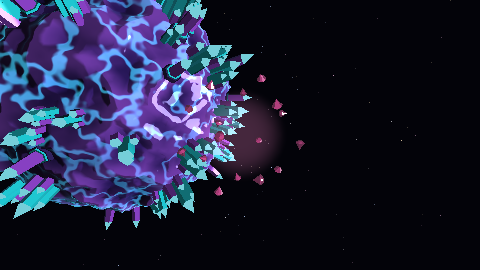

# Proyecto 3 — SPACE CRAFT MASTERS PRO +

**Integrantes:** Martin Villatoro (24033) · Esteban de la Peña (24171) · Emily Góngora (24308)

**🎬 [Ver video del recorrido](https://uvggt-my.sharepoint.com/:f:/r/personal/vil24033_uvg_edu_gt/_layouts/15/onedrive.aspx?id=%2Fpersonal%2Fvil24033%5Fuvg%5Fedu%5Fgt%2FDocuments%2F6o%2E%20Semestre%2FGraficas%2FVideo%20Proyecto%203&share=cgrv4iZIeQ6qQ4BN1avyYcV2EgUCR4gyZpII%5FHudufYB7LJgnw)**: vuelo espacial, acercamiento,
vuelta alrededor de un planeta y alejamiento.

## Descripción general

El proyecto consiste en un sistema solar explorable de estilo "mini-mundos",
compuesto por un sol animado y ocho planetas pequeños con identidad propia,
que se recorre a bordo de una nave controlada por quien juega. La totalidad
de la etapa tridimensional —transformaciones de modelo, vista y proyección,
recorte, eliminación de caras traseras, rasterización, prueba de
profundidad y sombreado por fragmento— está implementada en este
repositorio como un *software renderer*. La biblioteca raylib se emplea
únicamente para crear la ventana, leer el teclado y el mouse, presentar el
framebuffer como textura, dibujar la interfaz 2D y reproducir audio; no se
utiliza ninguna de sus funciones de dibujo 3D, cámara, modelos ni shaders de
GPU.

Sobre esta base se construyó una experiencia de juego completa: una
pantalla de inicio con selección de nave y de modo, tres naves con modelos y
comportamientos de vuelo diferenciados, un modo de exploración libre y un
modo de supervivencia con un enemigo que persigue al jugador, además de
efectos de sonido y música.

| Jungla jurásica | Planeta embrujado |
|---|---|
|  |  |


| Lava | Desierto y anillo de asteroides |
|---|---|
|  |  |

| Mecánico | Cristalino |
|---|---|
|  |  |

| Ciudad (día) | Ciudad (noche) |
|---|---|
|  |  |

| Hielo / océano | Hielo de noche, con aurora |
|---|---|
|  |  |

## Características que solicitamos evaluar

Total: **180 puntos técnicos** del menú (+ presentación). La nota máxima es 100.

| Característica | Pts | Dónde verlo |
|---|---|---|
| Planetas distinguibles que orbitan, rotan y se ven de cerca (hay 8, cuentan 5) | 50 | Jungla y Embrujado (`src/planets.rs`), Lava, Desierto, Mecánico y Cristalino (`src/mundos/esteban.rs`), Ciudad y Hielo (`src/mundos/emily/`) |
| Tipos de modelo propios sobre los planetas (4 × 5) | 20 | Palmera, helecho, esqueleto de dinosaurio, árbol seco, lápida, casona, fantasma, columnas de basalto, obsidiana, cactus, arcos, engranajes, antenas, cristales, monolitos, edificios, torre de radio, icebergs, iglús, faro… (scripts en `assets/models/`) |
| Distribución procedural reproducible con semilla | 10 | `src/props.rs` → `place`: dirección al azar con `Rng` sembrado, filtrada por ruido fBm, altura y pendiente. Test `same_seed_same_positions_and_on_surface` |
| Posición y orientación correctas sobre la superficie curva mientras el planeta rota | 5 | `src/props.rs` → `instance_matrix`: apoyado en la altura real, vertical = dirección radial; horneado en espacio local del planeta |
| Shaders propios con efecto distinto (4 × 6) | 24 | `src/shaders/`: sol, jungla, embrujado, toon, flama, fantasma y gema; lava, desierto, mecánico, cristalino, ciudad y hielo en `src/mundos/` |
| Shader animado | 8 | Plasma del sol, flama del propulsor, lava de la jungla, niebla y farolitos del embrujado, fantasmas, tráfico de la ciudad, olas y aurora del hielo, pulso de las gemas |
| Mapeo de normales | 8 | Olas del planeta Hielo: la normal se perturba con el gradiente analítico de las olas (`src/mundos/emily/hielo.rs` → `mar`) |
| Deformación de la geometría con ruido | 10 | `src/planet.rs` → `build_terrain_mesh`: cada vértice de la icosfera se desplaza con la función de altura (fBm / ridged) |
| Generación / subdivisión procedural de geometría antes de rasterizar | 10 | `src/mesh.rs` → `icosphere`: icosaedro subdividido 2 a 5 veces (320 a 20 480 triángulos) |
| Aceleración, frenado y giro progresivos, iguales a cualquier FPS | 8 | `src/ship.rs`: física con paso fijo de 120 Hz e interpolación, con parámetros propios por nave. Test `same_result_at_30_and_144_fps` |
| Modo de control local para rodear un planeta sin cortar el vuelo | 8 | Tecla **O** cerca de un planeta: la nave lo rodea sola a altura constante (W/S velocidad, Espacio/Ctrl altura, A/D inclinan la órbita, O la suelta y conserva la velocidad); la cámara se eleva para mostrar la superficie. `src/ship.rs` → `toggle_orbit` / `orbit_step`. Test `orbit_mode_circles_planet_at_constant_altitude` |
| Colisión que impide atravesar el planeta | 4 | `src/collision.rs`: usa la altura real del terreno; aviso "CONTACTO" en el HUD |
| Descarte de objetos fuera de la vista | 7 | `src/scene.rs` → `draw_body` (esfera envolvente contra el frustum). **F1** muestra los contadores y **F3** lo apaga: vista lejana 8 588 → 44 758 triángulos procesados |
| Niveles de detalle según la distancia | 8 | `src/scene.rs` → `select_lod` (malla según el tamaño en pantalla; objetos de superficie solo de cerca). **F4** lo apaga: vista lejana 8 588 → 255 502 triángulos procesados |

No implementado: atracción gravitatoria.

Los apartados de **presentación** (coherencia visual y claridad de la
experiencia) se apoyan en la pantalla de inicio, la ventana de controles,
los avisos del HUD y los dos modos de juego que se describen a continuación.

## Experiencia de juego

### Pantalla de inicio

Al ejecutar el programa se muestra el sistema solar en movimiento, recorrido
por una cámara cinemática, con un velo oscuro sobre el que se presenta la
interfaz. En el centro aparece la nave seleccionada, que gira sobre sí misma
junto con su nombre, una breve descripción y dos barras que resumen su
velocidad y su control. Debajo se eligen el modo de juego y, mediante el
botón **CONTROLES**, se puede consultar la lista completa de teclas.

La vista previa de la nave se renderiza en un framebuffer independiente de
240 × 90 píxeles con fondo transparente: el canal alfa se obtiene del
z-buffer (opaco donde el casco escribió profundidad) y, en el caso de la
flama aditiva, de su brillo. De esta forma la nave se compone encima de la
interfaz y no queda oculta por el velo ni por los planetas
(`Scene::render_ship_preview`).

### Naves

Se diseñaron tres naves propias, generadas por código en Blender, cada una
con un juego distinto de parámetros físicos (`SHIP_SPECS` en `src/config.rs`):

| Nave | Modelo | Comportamiento |
|---|---|---|
| **Pikmin Ship** (equilibrada) | Cohete caricaturesco de diseño propio (`nave_cohete.py`) | Velocidad máxima ≈ 27 u/s; respuesta intermedia |
| **Starfoz** (ligera) | Caza delgado gris con alas en flecha y cola en V (`naves_extra.py`) | Velocidad máxima ≈ 52 u/s; gira rápido pero con respuesta lenta, conserva la inercia lateral (derrapa) y frena con dificultad |
| **Tortuga** (pesada) | Casco ancho con blindaje y dos motores laterales (`naves_extra.py`) | Velocidad máxima ≈ 14 u/s; giro preciso, frenado enérgico y alto agarre lateral |

La diferencia de manejo no se limita a escalar la velocidad. Se introdujo un
término de **agarre** que amortigua exponencialmente la componente de la
velocidad perpendicular a la nariz de la nave: con agarre nulo la nave
conserva su inercia y derrapa, mientras que con agarre alto la trayectoria
sigue la orientación. Junto con la constante de respuesta del giro, esto
produce una nave ligera rápida pero difícil de dominar y una nave pesada
lenta pero muy controlable. Los tests `light_is_fastest_and_heavy_slowest`,
`heavy_goes_where_it_points_light_drifts` y `heavy_stops_and_settles_faster`
verifican estas propiedades. Durante el vuelo se puede cambiar de nave con
1/2/3 sin perder la posición ni la velocidad.

### Modo explorador

Corresponde al recorrido libre exigido por el proyecto: la nave puede
desplazarse por todo el sistema, acercarse a la superficie de cualquier
planeta, rodearlo con el modo órbita y alejarse sin transiciones ni
pantallas de carga.

| Starfoz | Tortuga |
|---|---|
|  |  |

### Modo supervivencia

En este modo cada planeta tiene una **gema** que lo orbita y el objetivo es
recogerlas todas (el contador del HUD indica, por ejemplo, `Gemas 3/8`)
mientras una nave enemiga, el **Devorador**, persigue al jugador. Se dispone
de **tres corazones**: cada contacto con el enemigo resta uno, empuja la nave
y concede dos segundos de invulnerabilidad (la nave parpadea). La partida se
pierde al agotar los corazones y se gana al reunir todas las gemas.

| Gema y Devorador | Efecto al recoger una gema |
|---|---|
|  |  |

Aspectos técnicos relevantes (`src/survival.rs`):

- **Persecución con anticipación.** El enemigo no apunta a la posición
  actual de la nave sino a la posición estimada `p + v·t`, con un horizonte
  proporcional a la distancia. Su velocidad angular está acotada, por lo que
  es posible esquivarlo con giros cerrados, y su rapidez máxima aumenta con
  cada gema recogida para elevar la dificultad.
- **Evasión de obstáculos.** Antes de avanzar, el enemigo suma a su
  dirección deseada una componente de repulsión por cada cuerpo que tenga
  enfrente y, además, se resuelven sus colisiones contra los planetas y el
  sol con el mismo sistema que usa la nave.
- **Gemas.** La malla de la gema se genera de forma procedural (mesa,
  corona y pabellón de ocho lados) con normales planas por faceta. Su shader
  (`src/shaders/gem.rs`) intensifica las facetas orientadas hacia la cámara y
  agrega un destello especular, y un halo aditivo pulsa a su alrededor.
- **Efecto de recolección.** Al tocar una gema se emite un destello aditivo
  que se expande y se desvanece, junto con dieciséis fragmentos que salen en
  direcciones distribuidas uniformemente sobre la esfera (espiral de ángulo
  áureo), giran y se reducen hasta desaparecer.
- **Interfaz.** El HUD muestra los corazones, el contador de gemas, la
  distancia al enemigo y el tiempo; marca en pantalla cada gema pendiente
  (proyectando su posición con la misma matriz de la cámara), indica con una
  flecha la dirección del enemigo cuando está fuera de la vista y enrojece
  el borde de la pantalla cuando se aproxima.

### Sonido y música

Los efectos de sonido se **sintetizan por código** al iniciar el programa
(`src/audio.rs`): se combinan osciladores (seno, cuadrada, triangular y
diente de sierra), ruido filtrado, barridos de frecuencia y envolventes, y el
resultado se empaqueta como WAV en memoria para que raylib lo reproduzca.
Hay efectos para la navegación del menú, el despegue, el cambio de nave, la
órbita, los choques, el turbo, las gemas, los golpes y el resultado de la
partida. El motor de la nave y el gruñido del enemigo son bucles continuos
cuyo volumen y tono dependen, respectivamente, de la potencia del motor y de
la distancia al enemigo; ambos se generan con un número entero de ciclos y
un fundido del ruido para que el empalme del bucle no produzca chasquidos
(test `loops_are_seamless`).

La música de fondo usa dos pistas en `assets/music/`: `main_theme.mp3` en el
menú y en el modo explorador, y `final_boss.mp3` en el modo supervivencia.
**Estos archivos no se incluyen en el repositorio** (ver
[Recursos externos](#recursos-externos-y-uso-de-ia)); si no están presentes,
el juego funciona con normalidad, solo sin música. La tecla **N** silencia
todo el audio.

## Integrantes

| Nombre | Carné | Contribución |
|---|---|---|
| Martin Villatoro | 24033 | Pipeline de rasterización, nave y física, colisiones, planetas/LOD/culling; modo órbita, pantalla de inicio, naves adicionales, modo supervivencia (enemigo, gemas y HUD), sonido y música |
| Esteban de la Peña | 24171 | Planetas Lava, Desierto, Mecánico y Cristalino, shaders, modelos y anillo de asteroides (`src/mundos/esteban.rs`) |
| Emily Góngora | 24308 | Planetas Ciudad y Hielo / océano: shaders (cuadrícula de calles por proyección de cubo, tráfico y luces nocturnas; olas con normal mapping procedural, espuma, casquetes y aurora), distribución de edificios en la cuadrícula y colonias de pingüinos, modelos (`src/mundos/emily/`, `assets/models/modelos_emily.py`) |

## Cómo ejecutar

Requisitos: Rust estable y `cmake` (macOS: `brew install cmake`).

```bash
cargo run --release
```

Para la música, colocar opcionalmente `main_theme.mp3` y `final_boss.mp3` en
`assets/music/`.

Pruebas automáticas (33 tests: matemáticas, malla, terreno, distribución de
objetos, física de las naves, órbita, enemigo, gemas y audio):

```bash
cargo test --release
```

Capturas sin abrir ventana (útiles para revisar el render):

```bash
cargo run --release -- --snapshot 10 captura.ppm cerca --planeta 2 --nave 1
```

Modos disponibles: `lejos`, `cerca`, `rasante`, `cabina`, `nave`, `choque`,
`inicio`, `orbita` y `supervivencia`; `--sin-culling`, `--sin-lod` y `--bench`
permiten comparar el trabajo del renderer.

## Controles

**Pantalla de inicio**

| Tecla | Acción |
|---|---|
| ← / → (o clic en las flechas) | Elegir nave |
| 1 / 2 / 3 | Elegir nave directamente |
| ↑ / ↓ (o clic en el botón) | Elegir modo: Explorador / Supervivencia |
| C (o clic en CONTROLES) | Mostrar / ocultar la ventana de controles |
| Enter | Despegar |

**En vuelo**

| Tecla | Acción |
|---|---|
| W / S | Acelerar / frenar (reversa suave) |
| Mouse o flechas | Cabeceo y guiñada (el mouse mueve una palanca virtual) |
| A / D | Alabeo (rodar) |
| Espacio / Ctrl | Subir / bajar |
| Shift | Turbo |
| O | Órbita automática alrededor del planeta cercano (O otra vez para soltarla) |
| C | Cámara: tercera persona / cabina |
| 1 / 2 / 3 | Cambiar de nave sin perder posición ni velocidad |
| R | Reiniciar la nave (en supervivencia, reiniciar la partida) |
| M | Volver a la pantalla de inicio (en supervivencia, presionar dos veces) |
| Enter | Volver al menú al terminar una partida de supervivencia |
| N | Silenciar / activar el sonido |
| Tab / Esc | Soltar / capturar el mouse |
| F1 | Panel de depuración (contadores del pipeline) |
| F2 | Cámara libre de depuración |
| F3 / F4 | Activar / desactivar culling y LOD (comparación) |

## Arquitectura

| Archivo | Qué hace |
|---|---|
| `src/math.rs` | Vectores y matrices propios (look-at, perspectiva, rotaciones) |
| `src/renderer.rs` | Pipeline: vertex stage, recorte, backface, rasterización multihilo, z-buffer, mezcla aditiva |
| `src/mesh.rs` | Icosfera subdividida, cono, cargador `.obj`/`.mtl` |
| `src/noise.rs` | Perlin 3D con semilla, fBm, ridged, ruido celular (Worley) |
| `src/planet.rs` / `src/planets.rs` | Planetas: órbita, giro, terreno deformado, LODs / catálogo |
| `src/scene.rs` | Culling, selección de LOD, orden de dibujo y vista previa de la nave del menú |
| `src/camera.rs` | Cámara en tercera persona, cabina, órbita y cámara libre |
| `src/ship.rs` | Física de vuelo con paso fijo de 120 Hz, parámetros por nave y modo órbita |
| `src/collision.rs` | Colisión contra planetas y sol con la altura real del terreno |
| `src/props.rs` | Objetos de superficie: distribución con semilla y ruido, orientación, horneado; fantasmas |
| `src/survival.rs` | Modo supervivencia: enemigo, gemas, corazones, efecto de recolección |
| `src/audio.rs` | Síntesis de efectos de sonido, bucles del motor y del enemigo, música |
| `src/config.rs` | Parámetros ajustables: resolución, cámara, naves, órbita, supervivencia |
| `src/main.rs` | Ventana, pantalla de inicio, bucle de juego y HUD |
| `src/shaders/` | Fragment shaders: sol, jungla, embrujado, toon (naves y objetos), flama, fantasma, gema y halo |
| `src/mundos/` | Planetas de Esteban y de Emily con sus shaders y modelos |
| `assets/models/nave_cohete.py` | Script de Blender que genera la Pikmin Ship |
| `assets/models/naves_extra.py` | Script de Blender que genera Starfoz, Tortuga y el Devorador |
| `assets/models/modelos_superficie.py` | Script de Blender: palmera, helecho, esqueleto, árbol seco, lápida, casona, fantasma |